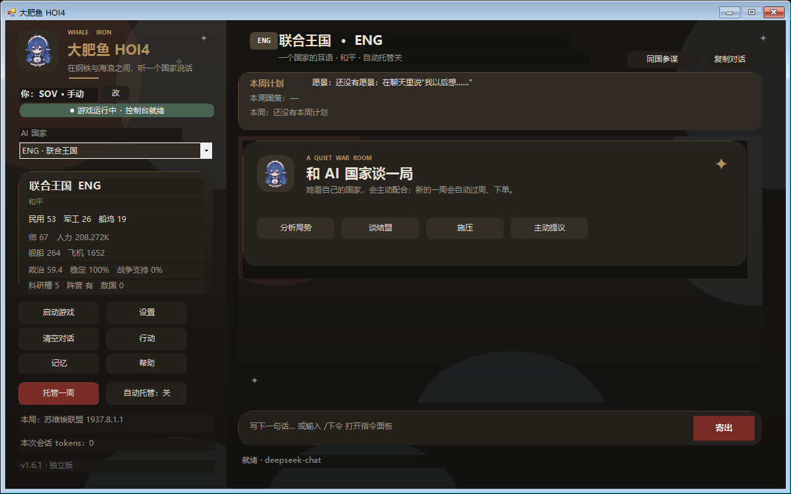

# DaFeiYu HOI4（大肥鱼 HOI4）

让《钢铁雄心 4》里的 AI 国家真正“会说话”：你玩一个国家，DeepSeek 扮演另一个国家；它读取自己的工厂、师、船、飞机、战争和阵营状态，记住你说过的话，和你谈判、拒绝、提条件。

**公开 Beta：v0.9.24**

> 这是独立项目，不依赖 NationMind。自己的配套 mod（`DFY|` 日志协议）+ 自己的外部 Windows 软件。
>
> 不是 HOI4 游戏内窗口，也不是 Steam 创意工坊一键版；原因见文末“游戏内窗口 / 创意工坊”。



## 这是什么

- **外部软件**：Windows PowerShell 5.1 + WinForms，读取 HOI4 日志，调用 DeepSeek API；
- **配套 mod**：每周把玩家国和 AI 国的状态、阵营、保障、敌国写入 `game.log`；
- **行动命令**：软件生成 `eval_effect ...` 或控制台命令并自动复制，玩家回游戏粘贴；
- **记忆**：按“玩家国 + 本局标题”隔离，支持本局摘要和承诺账本。

## 当前功能

- AI 聊天：选一个 AI 国家，以它的视角说话；
- 玩家国识别：读 `continue_game.json`，支持手动改；
- 本局状态：工厂、师、人力、舰船、飞机、政治点、稳定、战争支持、科研槽、阵营、敌国；
- 本局记忆：摘要、承诺、最近行动，可单独清空；
- 50 条行动，10 个类别：常用 / 外交 / 阵营 / 经济 / 科研 / 政治 / 军事 / 强制 / 对玩家 / 国家；
- 阵营管理：加入、踢人、退出、解散、改名、当领袖；
- 战争外交：宣战、白和、保障、通行、附庸、吞并；
- 经济内政：工厂、基建、科研槽、政治点、稳定、战争支持；
- 对玩家：装备、燃料、政治点、指挥点、人力、通行、阵营；
- 国家：转州、州宣称、州核心、焦点、国家精神（需要有效 ID）；
- 聊天框输入 `/下令` 可以直接打开指令面板；
- 高风险二次确认，极高风险会提示备份。

## AI 玩家模式

普通“AI 国家”模式不是外交官角色扮演，而是：

> **大肥鱼认为自己在玩这个国家。**

她有自己的目标、国策方向、建军/扩张计划；会主动提出配合、要求、交换，也会拒绝和改变国策方向。快捷问法里新增 **主动提议**。

如果她明确选择国策，会输出 `[FOCUS:焦点名/ID]`；软件核对本国焦点树后复制：

```text
eval_effect 国家 = { complete_national_focus = 焦点ID }
```

找不到焦点就不会生成命令。仍然要玩家回游戏粘贴，软件不自动执行。

## 托管一周（P1）

左侧 **托管一周**：

- 读取 AI 国家周快照和长期笔记；
- 只从允许的低风险动作里选 ≤6 条；
- 校验动作/目标/数值/命令前缀；
- 写 `dfy_orders.txt`，复制 `run dfy_orders.txt`；
- **不自动执行，不模拟键盘，不改聊天路径。**

P0 需要一次人工验证 `run dfy_p0_test.txt`；见 `docs/P0_RUN_TEST.md`。

## 行动方向（重要）

HOI4 的 `add_to_faction = TAG` 是：

> **当前国家把 TAG 加入自己的阵营。**

不是“当前国家加入 TAG 的阵营”。

所以“让英国加入你”不是：

```text
eval_effect ENG = { add_to_faction = GER }
```

而是由**玩家所在阵营的领袖**执行：

```text
eval_effect GER = { add_to_faction = ENG }
```

软件现在会自动找玩家所在阵营的领袖；如果 AI 本身就是这个领袖，会提示“不能加入自己”。

## 安装

1. 解压 ZIP 到任意文件夹（不要直接在压缩包里运行）；
2. 双击 **`安装.cmd`**；
3. 首次安装粘贴 DeepSeek API Key（只存本机，DPAPI 加密）；
4. 桌面出现 **“大肥鱼 HOI4”** 和 **“卸载大肥鱼HOI4”**。

安装只写两个地方：

- `%LOCALAPPDATA%\DaFeiYuHOI4`（软件本体）
- `Documents\Paradox Interactive\Hearts of Iron IV\mod\`（配套 mod）

不写注册表、不装服务、不改游戏本体、不需要管理员权限。

## 使用

1. 打开 HOI4，选国家开局；
2. 至少过一周，让 mod 写出状态；
3. 打开桌面 **“大肥鱼 HOI4”**；
4. 软件识别玩家国，选一个 AI 国家；
5. 在右下输入框聊天，或点“行动”/输入 `/下令` 直接下令；
6. 软件自动复制命令，回游戏按 `~`，`Ctrl+V`，回车。

第一次没状态：进游戏后等一周，或读一次档。

## 已验证 / 未完全验证

**已验证核心链：**

- 阵营：玩家加入、AI 加入、踢人、强制加入、强制退出、解散、当领袖；
- 战争：宣战、白和、吞并、附庸；
- 外交：保障、双方通行；
- 内政：焦点、国家精神；
- 数值：政治点、人力、稳定、战争支持、科研槽、指挥点、陆海空经验；
- 经济：民用/军工/船坞/基建投资日志；
- 州转移。

**尚未完全验证：**

- 装备库存的精确增量（命令和库存触发器通过，但没有逐件库存对比）；
- 燃料（执行前已高于测试阈值，证据偏弱）；
- 州宣称、州核心的界面显示；
- 阵营改名的界面显示；
- 部分需要文本输入的 UI 操作。

所以：**50 条命令都能解析执行，但不是 50 条都 100% 效果验证。** 公开 Beta 的意义就是让真实存档把隐藏问题跑出来。

## 同国参谋（Beta）

主界面右上角有 **“同国参谋”** 开关。

开启后：

- 不再选择 AI 国家，状态卡切到玩家国；
- 大肥鱼以玩家国总参谋身份说话；
- 快捷问法变成“下一步国策 / 内政优先级 / 战争风险”；
- 只给建议，不输出 `[ACTION]`，不生成控制台命令；
- 行动按钮禁用，避免误把玩家国当 AI 国。

这是 **A 方案：同国参谋**，不是同国代管。  
当前只能看每周国力快照，**看不到生产队列、建造队列、师编制、部队位置、焦点树进度**；她需要时会问你。

### 参谋资料

同国参谋模式下点 **“资料”**，可填写：

- 国策/分支：自动读取当前玩家国的焦点树，可搜索下拉，也可手写；可留空
- 科研：当前/下一项（可留空）
- 建造：队列/优先（可留空）
- 生产：装备/缺口（可留空）
- 编制/部队：主力/位置（可留空）
- 法律/顾问/政治（可留空）
- 目标/约束：想打谁、怕谁（可留空）

资料按本局玩家国保存，只进入参谋提示词，不会混进敌国对话。

## 当前限制

- 行动是**半自动**：命令由软件生成并复制，最后粘贴要你手动；
- HOI4 屏蔽模拟键盘，软件不能替你按 `~`；不装驱动、不碰杀软；
- 状态是**每周快照**，不是逐师/逐舰实时；
- 支持 HOI4 **1.19.x**，游戏更新后 mod 可能要适配；
- 需要 DeepSeek API Key，会产生 API 费用；
- 只有 Windows 版。

## 游戏内窗口 / 创意工坊

**目前做不到真正的游戏内 AI 聊天窗口。**

HOI4 的脚本 mod 能写 `on_actions`、decision、event、scripted GUI、localisation，但**不能发 HTTP 请求、不能读外部文件、不能启动外部程序**；STS2 那种嵌入 AI 窗口依赖代码级 mod API，HOI4 没有等价能力。

可行路线只有两条：

1. **外部置顶浮窗**：把现有软件做成无边框、置顶、半透明，贴在游戏上面，视觉上接近游戏内窗口；但仍是独立窗口，不能上传创意工坊；
2. **创意工坊配套 mod**：只上传状态日志/decision/GUI/本地化，AI 聊天仍由外部软件负责；订阅者仍要安装 GitHub 上的软件和 API Key，不是一键版。

所以：**GitHub 可以先上；创意工坊要等“配套 mod + 外部软件”这条路验证过再考虑。**

## 目录

```text
dafeiyu-hoi4/
  app/DaFeiYuHOI4.ps1       外部软件
  app/actions.ps1           50 条行动目录
  mod/dafeiyu_hoi4/         配套 mod
  installer/install.ps1     一键安装
  installer/uninstall.ps1   一键卸载
  docs/                     截图
  安装.cmd / 卸载.cmd
```

## 开发

- 外部软件：Windows PowerShell 5.1 + WinForms（系统自带，无 Python/Node 依赖）；
- mod：Clausewitz 脚本，`on_startup` / `on_weekly` 写 `DFY|state|...`；
- 软件读日志 → 调 DeepSeek → 聊天/记忆/行动；
- `actions.ps1` 是独立行动目录，主脚本通过 `$PSScriptRoot` 加载。

## 发布

- GitHub Release：https://github.com/QuanWander/dafeiyu-hoi4/releases
- 资产：`DaFeiYuHOI4-v0.9.24.zip`、`SHA256SUMS.txt`
- 发布说明：[RELEASE_NOTES.md](RELEASE_NOTES.md)

## License

MIT。独立实现；没有复制或运行 NationMind 的代码。见 [NOTICE.md](NOTICE.md)。

Hearts of Iron IV 是 Paradox Interactive 的商标；本项目与 Paradox 无隶属或背书关系。
