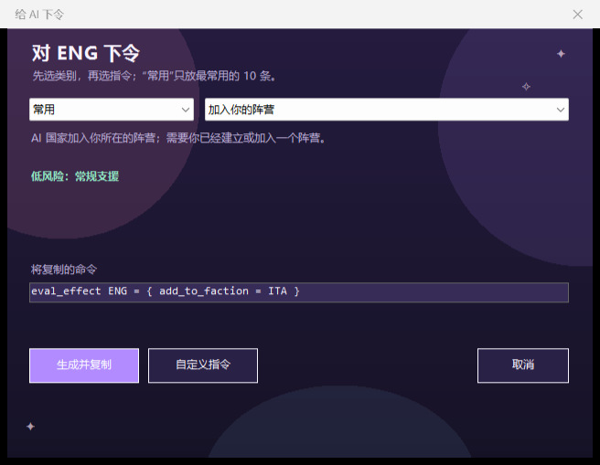
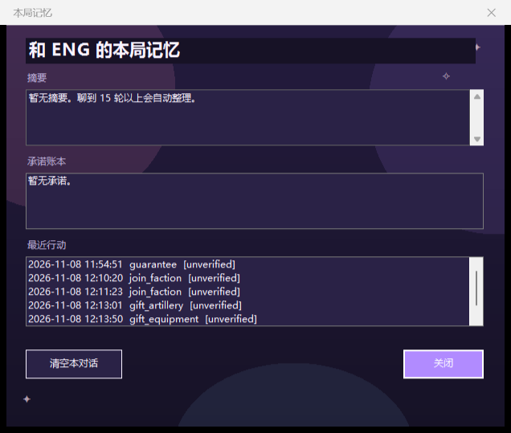
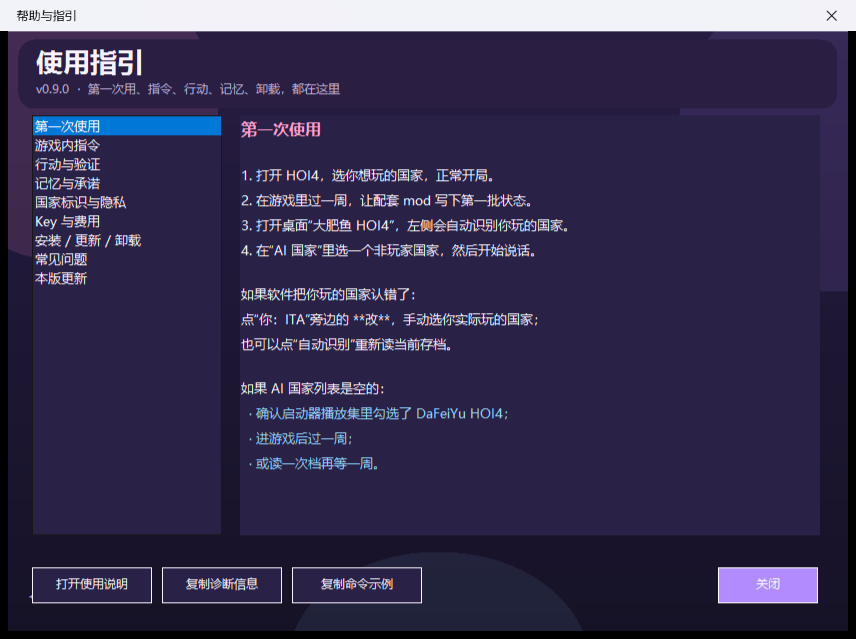

# DaFeiYu HOI4（大肥鱼 HOI4）

让《钢铁雄心 4》里的 AI 国家真正“会说话”：你玩一个国家，DeepSeek 扮演另一个国家；它会看自己的工厂、师、船、飞机和战争状态，记住你说过的话，和你谈判、拒绝、提条件。

**这是独立项目，不依赖 NationMind。** 自己的配套 mod（`DFY|` 日志协议）+ 自己的外部软件。

> **第一次安装：先看 [安装教程.txt](安装教程.txt)**（解压、安装、Key、播放集、进游戏、指令、卸载）。

> 当前版本 **v0.9.0**：聊天 + 半自动行动 + 本局摘要/承诺 + 真实国旗 + 政治点/稳定度/战争支持/科研槽/阵营；安装器会检测 HOI4，卸载可备份记忆。


## 一键安装

1. 解压 ZIP 到任意文件夹（不要直接在压缩包里运行）；
2. 双击 **`安装.cmd`**；
3. 首次安装粘贴 DeepSeek API Key（只存本机，DPAPI 加密）；
4. 桌面出现 **“大肥鱼 HOI4”** 和 **“卸载大肥鱼HOI4”**。

安装只写两个地方：

- `%LOCALAPPDATA%\DaFeiYuHOI4`（软件本体）
- `Documents\Paradox Interactive\Hearts of Iron IV\mod\`（配套 mod）

**不写注册表、不装服务、不改游戏本体、不需要管理员权限。**

## 使用

1. 打开 HOI4，选你想玩的国家，正常开局；
2. 至少过一周（mod 每周写一次状态）；
3. 打开桌面 **“大肥鱼 HOI4”**：
   - 软件会自动识别你玩的国家；
   - 在“AI 国家”里选要让大肥鱼扮演的国家；
   - 在右下输入框说话，回车发送。
4. 第一次没状态：进游戏后等一周，或读一次档；mod 只记录**非玩家**国家。

## v0.3 行动（半自动）

HOI4 不接受软件模拟按键（`SendInput` / `PostMessage` 都实测无效），所以软件不能替你按 `~` 和回车。流程是：

1. 你在聊天里和 AI 谈成；
2. AI 在回复末尾带 `[ACTION:...]`，软件自动弹出“AI 行动”，**命令已自动复制**；
3. 回到游戏按 `~` 打开控制台，`Ctrl+V` 粘贴，回车。

约 10 秒，但可靠、不装驱动、不碰杀软。同一个行动 45 秒内重复会先问一句。

支持的行动：

| 行动 | 命令 | 说明 |
|---|---|---|
| 加入你的阵营 | `eval_effect ENG = { add_to_faction = GER }` | 需要你已有阵营 |
| 保障你的独立 | `eval_effect ENG = { give_guarantee = GER }` | 被保障后它会参战 |
| 扩建民用工厂 | `eval_effect ENG = { dfy_action_invest_civ = yes }` | 随机州 +1 民用 |
| 扩建军工 | `eval_effect ENG = { dfy_action_invest_mil = yes }` | 随机州 +1 军工 |
| 增加科研槽 | `eval_effect ENG = { add_research_slot = 1 }` | 比较强，慎用 |

左侧 **“行动”** 按钮也可以不聊天，直接选行动生成命令。



## v0.4 记忆与美术

- 聊到 15 轮以上，自动把旧消息压成**本局摘要**，并提取**承诺账本**；
- 左侧“记忆”能看摘要、承诺、最近行动，可以单独清空；
- 摘要和承诺会重新喂给 AI，聊久了不会忘；
- UI 加了渐变、DFY Logo、国家色块、头像气泡、状态胶囊、快捷话术；
- 行动窗口改成三步大图，自动复制，并记录 pending/applied/unverified。



## v0.5 状态、细节、安装

- 状态卡新增：政治点、稳定度、战争支持度、科研槽、是否在阵营；
- 国家下拉显示“ENG · 联合王国”，不再只有代码；
- 消息带时间，右上角 **复制对话** 可整段复制；
- 设置里加 **测试 Key**；
- 安装器检测常见 HOI4 路径，找不到会提示；
- 卸载时可把 `memory.json`/`actions.json` 备份到 Documents；
- Release 附 SHA256 校验和与发布说明。

## v0.8 行动自由度

- “行动”改成“给 AI 下令”：玩家主动选，不必等 AI 同意；
- 46 条指令，先选类别再选指令；默认“常用”只有 10 条；
- 外交：结盟、保障、退阵营、宣战、白和；
- 经济：民用工厂、军工、船坞；
- 科研：科研槽；
- 政治：政治点、稳定度、战争支持度；
- 军事：指挥点、人力、装备、燃料、陆/海/空经验；
- 强制/不平等：拉目标进阵营、逼目标退阵营、强制通行、附庸、吞并；
- 对玩家：给通行、邀请/逼退阵营、送装备/燃料/政治点/指挥点/人力、打压稳定/战争支持；
- 国家：转州、州宣称、设核心、完成焦点、加国家精神（需要手动填 ID）；
- 装备支持：步兵、支援、火炮、轻坦、战斗机、运输船；
- 强制目标必须手动选，不会默认打到你自己；
- 支持目标国家和数值，先预览命令再复制；
- 高风险标红，极高风险二次确认；还有任意 effect 的自定义指令。

## v0.7 帮助中心

- 主界面新增 **帮助** 按钮；
- 第一次安装、以及每次版本更新，会自动打开一次帮助；
- 帮助里讲清：第一次使用、`~ / Ctrl+V / 回车`、行动验证、记忆、隐私、Key、安装卸载、常见问题；
- 可直接打开使用说明、复制诊断信息、复制命令示例；
- 玩家国识别错了，点“你：…”旁边的 **改** 手动选；
- 帮助内容跟着 `appVersion` 更新，不会只留在 README 里。



## v0.6 鲸语拾光 UI

- 暮色玻璃、粉紫蓝光晕、鲸鱼形象、渐变标题；
- 圆角玻璃卡片、细描边、星屑点缀；
- 聊天气泡改成粉紫/青绿头像与柔光边框；
- 欢迎卡改成“安静的战情室”，快捷话术保留；
- 聊天输入框文案改为“写下一句话，寄给这个国家…”，发送按钮“寄出”；
- 国家标识统一用“字母 + 色块”，不显示任何真实国旗；
- 不再依赖 HOI4 游戏旗帜素材。


## v0.5.1 软件级补强

- mod 每周输出 `DFY|faction`、`DFY|guarantee`、`DFY|guaranteed_by`、`DFY|enemy` 关系日志；
- 软件聚合后显示敌国数量；
- 结盟、保障行动在下一周用关系日志验证，能标 applied/unverified；
- 摘要阈值从 18 条提到 30 条，减少一次 API 的触发频率。

## v0.2 界面

- 左右聊天气泡，不再是一整块黑底文字；
- 左侧国家卡显示民用/军工/船坞/师/人力/舰船/飞机/战争状态；
- 底部显示本局和本次会话 tokens；
- “设置”里可换模型、换 Key；
- 记忆按**玩家国 + 本局标题**隔离，换局不会串话；同一局读档不会丢。

## 卸载

双击桌面 **“卸载大肥鱼HOI4”**，输入 `Y`：

- 删除配套 mod、桌面快捷方式、软件本体；
- **不动存档、游戏本体、其他 mod**；
- `dlc_load.json` 会先备份为 `.bak-dfy-uninstall`。

## 杀毒软件说明

- 全部是纯文本 `.ps1` / `.cmd`，没有 `.exe`、没有加壳、没有 `EncodedCommand`、不下载可执行文件；
- 只做复制文件、写 `dlc_load.json`、创建快捷方式；
- 个别杀软可能对“PowerShell 安装脚本”误报。源码完全公开，可逐行检查；如被拦截，选择“允许/信任”即可。

## 当前限制

- 行动是**半自动**：命令由软件生成并自动复制，最后粘贴要你手动；
- 无法做到全自动，因为 HOI4 屏蔽模拟键盘；驱动级模拟会被杀软拦，本项目不做；
- 投资/军工/科研槽/结盟/保障可用下一周状态验证；命令本身仍可能因游戏条件失败；
- 状态是**每周**快照，不是逐师/逐舰实时；
- 支持 HOI4 **1.19.x**；游戏更新后 mod 可能要适配；
- 需要 DeepSeek API Key，会产生 API 费用（通常一局几毛到几块，摘要阈值已提高到 30 条）。

## 目录

```text
dafeiyu-hoi4/
  app/DaFeiYuHOI4.ps1       外部软件（WinForms）
  mod/dafeiyu_hoi4/         配套 mod（DFY 状态日志）
  installer/install.ps1     一键安装
  installer/uninstall.ps1   一键卸载
  安装.cmd / 卸载.cmd
```

## 开发

- 外部软件：Windows PowerShell 5.1 + WinForms（系统自带，无 Python/Node 依赖）
- 配套 mod：Clausewitz 脚本，`on_startup` / `on_weekly` 写 `DFY|state|...` 到 `game.log`
- 软件读日志 → 调 DeepSeek → 聊天/记忆；行动由 AI 输出标记，软件生成命令并复制，玩家在控制台粘贴执行。

## 发布

- 发布包：`dist/DaFeiYuHOI4-v0.6.2.zip`
- 校验和：`dist/SHA256SUMS.txt`
- 发布说明：[RELEASE_NOTES.md](RELEASE_NOTES.md)

## License

MIT。独立实现；没有复制或运行 NationMind 的代码。见 [NOTICE.md](NOTICE.md)。
